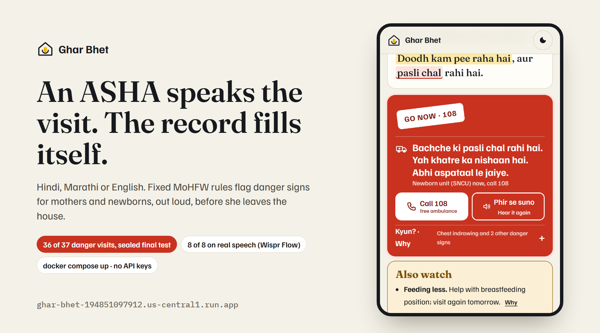
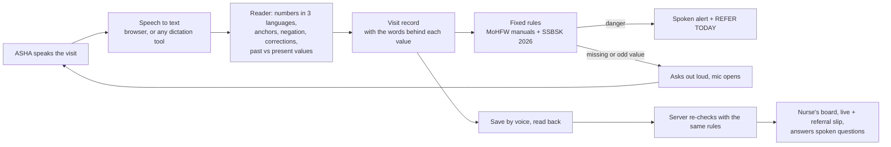

<p align="center"></p>

<p align="center">


</p>

# Ghar Bhet

**An ASHA (village health worker) speaks a home visit in Hindi, Marathi or English. The danger-sign and vital fields of the official visit form fill themselves, and fixed government rules flag the danger signs that need a same-day referral, out loud, before she leaves the house.** *Ghar bhet* means "home visit" in Hindi and Marathi.

- **What it does:** turns a spoken visit (newborn, pregnancy, or mother after birth) into a checked record, with the words behind every value, and raises a referral the nurse sees at once when a danger sign is present.
- **Who it's for:** India's **10.29 lakh ASHAs** (PIB, Jan 2025) and the nurses (ANMs, auxiliary nurse-midwives) they report to.
- **Measured accuracy, first run on 60 visit transcripts it had never seen** (written the way ASHAs speak, not recorded): **96.6%** of record fields read correctly (281 of 291), **98.6%** precision, **37 of 38** danger visits flagged (against our own rule table), **1 of 22** normal visits wrongly flagged. On a harder independent set of 100 tricky visits, written by a separate agent that never saw the code, the first run read 88.3% of fields and caught 50 of 59 danger visits (7 of 41 false alarms); on a second independent set of 60 in mostly English clinical shorthand it read 80.3% of fields and caught 36 of 39 danger visits, but raised 9 false alarms in 21 normal visits. [Every result and every miss](https://ghar-bhet-194851097912.us-central1.run.app/evidence).
- **Final sealed test, run once:** 60 visits written after all the fixes and kept unopened until the end: 91.1% of fields, 36 of 37 danger visits flagged, 1 of 23 normal visits wrongly flagged.
- **Real speech (12 visits read aloud through Wispr Flow):** 8 of 8 danger visits flagged, 70.2% of fields read right.
- **Run it in one command:** `docker compose up`, then open http://localhost:8080. No API keys, no accounts, no AI model of our own.
- **Live demo:** https://ghar-bhet-194851097912.us-central1.run.app (no login). Without a microphone: https://ghar-bhet-194851097912.us-central1.run.app/visit?example=1

**Theme:** Healthcare access · **State:** Maharashtra · **Built for:** Scaler × Wispr Flow "India Runs on Voice", Round 2 · **Builder:** Rohan Borade (solo)

## Try it in one minute

1. Open the [visit page](https://ghar-bhet-194851097912.us-central1.run.app/visit) in Chrome or Edge. Pick **Newborn** and **Hindi**.
2. Tap the mic once and say: *"Sunita ka baby, saat din ka hai. Wajan ek kilo saat sau gram. Doodh kam pee raha hai, aur pasli chal rahi hai."* (Sunita's baby is 7 days old, weighs 1.7 kg, is feeding less, and her chest pulls in.) No microphone? Tap the first example.
3. The tiles fill: 7 days, 1700 g, feeding poorly, chest indrawing. The phone says the danger aloud in Hindi and stamps **REFER TODAY**.
4. It asks what's missing ("What is the baby's temperature?") and listens for your answer. Say a number, "nahi" to a yes/no question, or "chhodo" to skip.
5. Say **"save karo"**. It reads the visit back in Hindi; say **"haan"**.
6. Open the [nurse's board](https://ghar-bhet-194851097912.us-central1.run.app/anm): the referral is there with a printable slip. Tap its mic and ask *"Aaj kaun kaun refer hua?"* (Who was referred today?); it answers out loud.

## How it meets the Round 2 brief

The brief asks for "something people in India do today by typing, tapping or filling forms", made to work by voice. An ASHA fills a visit form by hand for every home visit, and often types it again into an app. Ghar Bhet makes that form work by voice. The organisers' "How to approach it" has four parts; here is each one, in their words.

### 1. Judge the idea: "Is the problem real and frequent, and does voice make it better?"

- **Real.** Watched on 45 home newborn visits, ASHAs checked for lethargy in 33% and jaundice in 24%, and "had difficulty sequentially asking questions and examining newborns while simultaneously recording information" (Das et al., *Indian Pediatrics* 2014;51:142). In Pune district, two-thirds of ASHAs felt tired and rushed, and low literacy affected record keeping (Kawade et al., *Human Resources for Health* 2021). ASHAs in Maharashtra describe writing every visit twice, on paper and in apps, late into the night (New Lines Magazine).
- **Frequent.** About 1.5 crore newborns a year get ASHA home visits (SSBSK 2026), at least 4 visits each: over 6 crore newborn visit records a year, before pregnancy and after-birth visits. India registered 2.54 crore births in 2022 (CRS).
- **Voice makes it better.** Her hands are on a baby, a thermometer or a weighing sling; speaking keeps them there while the record fills, which is exactly the difficulty the 2014 study saw. In a 2024 pilot ASHAs found typing Hindi hard and used voice dictation instead (ASHABot, arXiv 2409.10913). And a danger sign said out loud is heard in the home, not found later at her desk.

### 2. Design it voice-first: "People finish the main flow by speaking."

The whole visit is done by voice, with one tap to start:
- she speaks the visit; the app asks out loud for anything missing (the name first) and **opens the mic for the answer by itself**; the breath count is a timed minute with a tick every 15 seconds;
- she answers with a number, "haan" or "nahi", corrects herself, even in the next sentence ("nahi nahi, 37.8" goes to the value she just gave, and the phone says the new value back), or says "chhodo" (skip), "pata nahi" (not checked), "ruko" (wait, I'm measuring: the mic stays open 2 minutes) or "bas" (stop); odd values are asked back ("Did you say 400 grams?");
- danger signs are spoken in her language, with the action to take; urgent ones are marked **GO NOW · 108**, and "watch" advice is spoken too;
- "save karo" reads back the name, the danger values and the result in her language and saves on "haan"; it then says the referral has gone to the nurse and listens for "naya" (next visit);
- voice commands also change the visit type, the language, start a new visit ("naya") or undo ("wapas");
- the nurse asks the board out loud: who was referred (urgent first), whose visits are due, how one person is, "Sunita dekh liya" (mark as seen), or "Sunita PHC pahunchi" / "gaye nahi" (the referral's outcome; refused or unknown cases come back as a follow-up the next day).

The mic pauses while the phone speaks, so it never hears itself, and tones mark when the mic opens and closes; an answer that repeats the question's words ("doodh kam pee raha hai") is never mistaken for the phone's own voice. The mic panel always shows the current question in Roman Hindi or Marathi with English underneath, and when Hindi or Marathi is chosen the alert's main line is shown in Roman script, matching what the phone says. Typing is only a fallback, for browsers without speech recognition or a blocked mic. With no internet, the app tells her to use the keyboard's own mic (which can work offline) and reads what it types without a tap; a saved visit waits on the phone and is sent when signal returns.

### 3. Build a working prototype: "Use a coding tool and Wispr Flow for one narrow use case."

- **One narrow use case, end to end:** a home visit becomes a checked record and, if needed, a referral the nurse sees at once. It works on the live link and with `docker compose up`.
- **Coding tool:** built during the hackathon (first commit 27 Nov 2026) with a coding tool. About 11,100 lines of our own code and tests: the reader (`understand.js`, about 1,640 lines), the rules (`rules.js`, about 940), the server (about 1,080), the pages, 139 automated tests and a 97-scenario browser voice test. What was built when: [BUILD-LOG.md](BUILD-LOG.md).
- **Wispr Flow:** the visit page's text box works with any dictation tool that types, and Wispr Flow was used for our real-speech test: on the [real speech test page](https://ghar-bhet-194851097912.us-central1.run.app/dictation.html) the builder read 12 test visits aloud through Wispr Flow (and, separately, through Chrome's mic), and the reader was scored on exactly what the engine wrote. Wispr Flow: 70.2% of fields, 8 of 8 danger visits, 0 of 4 false alarms. Chrome's mic: 54.4% of fields, 7 of 8 danger visits. Raw transcripts and scores: [eval/realspeech/](eval/realspeech/) and the [evidence page](https://ghar-bhet-194851097912.us-central1.run.app/evidence).

### 4. Test it: "A few real users should finish the task unaided."

- **Accuracy, first run:** 60 held-out visit transcripts in Hindi and Marathi (Devanagari and Roman script), Indian English and mixed language. They and their right answers were written from the spec alone by a separate AI writing pass that never saw the code. 96.6% of fields, 37 of 38 danger visits, 1 of 22 false alarms. With today's larger rule table the same 60 give 99.3% of fields, 45 of 45 danger visits and 0 of 15 false alarms (the new rules turn 7 visits that were normal under the old rules into referrals, per SSBSK 2026 Forms 3 and 4, so the split moved from 38/22 to 45/15). That is after tuning, so the first run is the honest number. Final sealed test, run once: 60 visits written after all the fixes and kept unopened until the end: 91.1% of fields, 36 of 37 danger visits flagged, 1 of 23 normal visits wrongly flagged.
- **A harder, independent test:** 100 deliberately tricky visits (colloquial danger phrases, other people's symptoms, denials, mild vs severe, exact thresholds), written by a separate agent given only the spec. Run once before any change: 88.3% of fields, 50 of 59 danger visits caught, 7 of 41 false alarms. A second independent set of 60 in mostly English clinical shorthand ("no h/o fits", "temp 101.4F", "wt 2.1kg"), run once against the reader as it was: 80.3% of fields, 36 of 39 danger visits, but 9 of 21 false alarms. These are the more realistic numbers; the misses were fixed afterwards and are listed in [eval/README.md](eval/README.md).
- **Against the guidelines, not our own rules:** short cases labelled "should refer" straight from the guideline text, before the rules were run. The first run, with the first 37-rule table, caught only 11 of 24 that should refer; that gap is why the table grew. The cases are tuned on since (52 now), so the first run is the number to trust. Recorded in [eval/README.md](eval/README.md). A fresh sealed set of 40 cases labelled from the guideline text (each label quotes its page), written by a separate agent and run once on the shipped rules: 25 of 27 that should refer were caught, 10 of 13 that should not were left alone, and 19 of 23 urgent cases got an urgent flag.
- **Real speech:** The builder read 12 test visits aloud. Through Wispr Flow: 70.2% of fields read right (98.2% for the same visits as written text), 8 of 8 danger visits flagged, 0 of 4 false alarms. Through Chrome's built-in mic: 54.4% of fields, 7 of 8 danger visits (it wrote "bata" as "baat" and lost a BP of 160/110), 0 of 4 false alarms. Mishearings cost fields far more than danger flags.
- **Real users unaided:** not done yet. No one outside the team has tried it unaided; the protocol is ready in [docs/USER-TEST.md](docs/USER-TEST.md), and rows are added only after a real person has tried it.

## What it depends on, and what happens if that gets costly or stops

| Part | Uses today | If it gets costly or stops |
|---|---|---|
| Hearing her voice | The browser's speech recognition: Google's online service in Chrome, Microsoft's in Edge (hi-IN, mr-IN, en-IN). Free, needs a connection; we store no audio. | Typing always works. Any dictation tool that types text works, such as Wispr Flow. India's own speech services (Bhashini; IIT Madras's ASR lists Hindi and Marathi) or open models such as AI4Bharat IndicConformer can be swapped in. Chrome is adding on-device recognition. |
| Reading the visit | Our rule-based reader, `public/js/understand.js` | Nothing to stop: no AI API, no key, no fee per visit |
| Danger rules | A fixed, cited table, `public/js/rules.js` (90 rules, rule set mohfw-2026.6) | Versioned in code; an update is a reviewed change, not a model retrain |
| Speaking alerts | The phone's own voices | Every alert is also on screen as text |
| No signal | Typing works offline | Saved visits wait on the phone and are sent when signal returns |
| The register | A small Node server; on the live demo it is backed up to the app's own Cloud Storage bucket (free tier) | Runs on any server or a PHC laptop with `docker compose up` (a local JSON file) |

## How it works



- `public/js/understand.js`: the reader. Number words in Hindi, Marathi and English (dedh sau = 150, saadhe aath = 8.5, deedshe = 150, "one forty" = 140, "ek kilo saat sau gram" = 1700 g, "2,400 grams"), Fahrenheit to Celsius, BP said as "by", "bata" or "upar/neeche", negation ("sujan nahin hai", "taap naahi", "no fits", "jhatke? nahi"), self-corrections, past values ("pichli baar") losing to today's, other people's symptoms (the mother-in-law's) left out, and odd values ("400 grams") asked back. Roman letters for display.
- `public/js/rules.js`: 90 rules (rule set mohfw-2026.6), each with its threshold, source document and page or table, and spoken lines in Hindi, Marathi and English. `noted()` lists any sign she said that no rule covers, so nothing she says is silent.
- `public/js/visit.js`, `voice.js`, `ask.js`: the voice loop on the phone and the nurse's spoken questions.
- `server/`: a zero-dependency Node server. It keeps the village register, re-checks every saved visit with the same rules (a client can't send its own flags), rate-limits writes, and streams referrals to the nurse's board with server-sent events.
- `eval/`: the record spec, the test sets, the checker that re-computes every right answer from the spec, and `run.js`. [eval/README.md](eval/README.md) says which command gives which published number.

```bash
npm test                          # reader, every rule threshold, server, known failure cases
node eval/run.js heldout          # the held-out set with today's rules
node eval/run.js vignettes        # the guideline cases
# 97 browser voice scenarios with a fake recogniser:
#   npm i --no-save playwright && npx playwright install chromium
#   PORT=8091 ALLOW_RESET=1 node server/index.js   (in another terminal)
npm run e2e -- http://localhost:8091
```

## Honest limits

- **Not a medical device.** The rules support the nurse's and doctor's judgement and never replace it. No clinician has reviewed the table yet; a PHC medical officer's review is the first step of the pilot.
- **The main test sentences are written, not recorded.** They are in the style ASHAs speak. Real speech is measured on a small set (Wispr Flow and the browser mic); a pilot must measure it at scale.
- **Speech recognition depends on the browser** and needs a connection. Chrome and Edge listen in Hindi, Marathi and English; other browsers can type.
- **The village on the nurse's board is a made-up sample.** Visits you speak are added to it live. The demo board is open so anyone can try it; a pilot adds a nurse login.
- **Not integrated with government systems** (RCH, ANMOL, the planned Shaishav app). The record follows the MCP card and SSBSK fields so it could feed them.

## Sources

Every threshold, with its source, is in [docs/RESEARCH.md](docs/RESEARCH.md) and on the [rules page](https://ghar-bhet-194851097912.us-central1.run.app/how). Key documents: SSBSK Operational Guidelines 2026; MoHFW/NHSRC CHO training manuals on pregnancy and on newborn health (2021); HBNC Operational Guidelines 2014; the Mother and Child Protection card; SBA guidelines 2010; Maternal Near Miss guidelines 2014.

## License

MIT
