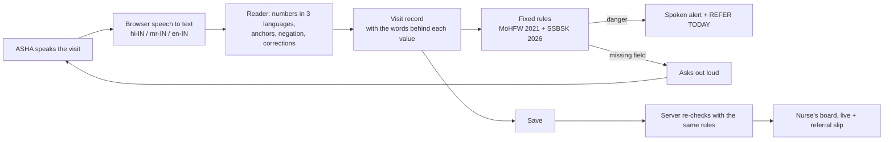

<p align="center"></p>

<p align="center">


</p>

# Ghar Bhet

**An ASHA health worker speaks a home visit in Hindi, Marathi or English. The official visit record fills itself, and fixed government rules flag the danger signs that kill mothers and newborns, out loud, before she leaves the house.**

- **What it does:** turns one spoken sentence into a checked visit record (newborn, pregnancy, or mother after birth), with the words behind every value, and raises a same-day referral when a danger sign is present.
- **Who it's for:** India's **10.29 lakh ASHAs** (PIB, Jan 2025) and the ANMs (nurses) they report to.
- **Measured accuracy, on 60 spoken visits it had never seen (first run):** **96.6%** of record fields read correctly (281 of 291), **98.6%** precision, **37 of 38** danger visits flagged, **1 of 22** normal visits wrongly flagged. After fixing the two gaps that run exposed: 99.3% of fields, 38 of 38 danger visits, 0 false alarms. [Every result and every miss](https://ghar-bhet-194851097912.us-central1.run.app/evidence).
- **Run it in one command:** `docker compose up`, then open http://localhost:8080. No keys, no accounts, no AI service.
- **Live demo:** https://ghar-bhet-194851097912.us-central1.run.app (no login). Try an example without a microphone: https://ghar-bhet-194851097912.us-central1.run.app/visit?example=1

**Theme:** Healthcare access · **Built for:** Scaler × Wispr Flow "India Runs on Voice", Round 2 · **Builder:** Rohan Borade (solo), Maharashtra

## Try it in one minute

1. Open the [visit page](https://ghar-bhet-194851097912.us-central1.run.app/visit). Pick **Newborn** and **Hindi**.
2. Tap the mic (Chrome or Edge) and say: *"Sunita ka baby, saat din ka hai. Wajan ek kilo saat sau gram. Doodh kam pee raha hai, aur pasli chal rahi hai."* No microphone? Tap the first example.
3. Watch the tiles fill: day 7, 1700 g, feeding less, chest indrawing. The phone says the danger aloud and stamps **REFER TODAY**.
4. It asks for what's missing ("What is the baby's temperature?"). Answer, or tap **Save visit**.
5. Open the [nurse's board](https://ghar-bhet-194851097912.us-central1.run.app/anm): the referral is there, with a printable slip.

## How it meets the Round 2 brief

The organisers' "How to approach it" has four parts. Here is each one, in their words, and how Ghar Bhet answers it.

### 1. Judge the idea: "Is the problem real and frequent, and does voice make it better?"

- **Real and frequent.** Every ASHA records home visits for every pregnancy and newborn in her village; around 1.5 crore newborns a year get ASHA home visits (SSBSK guidelines 2026). ASHAs keep a village health register, a diary and due lists, and are increasingly asked to re-enter the same visits in apps.
- **Voice makes it better.** Her hands are busy with a baby, a thermometer or a weighing sling. In a 2024 study ASHAs found typing Hindi hard and used voice dictation instead (ASHABot, arXiv 2409.10913). Speaking is how she already reports to the ANM, and a danger sign said out loud is heard in the home, not later at her desk.

### 2. Design it voice-first: "People finish the main flow by speaking."

The whole visit is done by voice: she speaks the visit, the app asks out loud for anything missing ("Did you check her Hb?"), she answers by voice, corrects herself by voice ("nahi nahi, 150 by 100": the last value said wins), and can say "save". Danger alerts are spoken in her language. Typing exists only as a fallback for browsers without speech recognition.

### 3. Build a working prototype: "for one narrow use case."

One narrow flow, end to end: **a home visit becomes a checked record and, if needed, a referral the nurse sees at once.** It works today on the live link and with `docker compose up`.

### 4. Test it: "A few real users should finish the task unaided."

- **Accuracy test:** 60 held-out spoken visits, written by a separate writer who never saw the code, in Hindi and Marathi (Devanagari and Roman script), Indian English and mixed language. Results above and on the [evidence page](https://ghar-bhet-194851097912.us-central1.run.app/evidence), misses included.
- **User test:** see [docs/USER-TEST.md](docs/USER-TEST.md) for who tried it unaided and what happened.

## What it depends on, and what happens if that gets costly or stops

| Part | Uses today | If it gets costly or stops |
|---|---|---|
| Hearing her voice | The browser's own speech recognition (Chrome, Edge) in hi-IN, mr-IN, en-IN | Typing always works; any speech engine that returns text can be swapped in |
| Reading the visit | Our rule-based reader, `public/js/understand.js` | Nothing to stop: no AI API, no key, no fee per visit |
| Danger rules | A fixed, cited table, `public/js/rules.js` (37 rules) | Versioned in code; an update is a reviewed change |
| Speaking alerts | The phone's own voices | Every alert is also on screen as text |
| The register | One JSON file on a small server | Runs on any server or a PHC laptop |

## How it works



- `public/js/understand.js`: the reader. Number words in Hindi, Marathi and English (डेढ़ सौ = 150, साढ़े आठ = 8.5, दीडशे = 150, "one forty" = 140, "ek kilo saat sau gram" = 1700 g), Fahrenheit to Celsius, negation ("सूजन नहीं है", "ताप नाही", "no fits"), self-corrections, months vs weeks, Roman letters for display.
- `public/js/rules.js`: 37 danger rules, each naming its source.
- `server/`: a zero-dependency Node server. It keeps the village register, re-checks every saved visit with the same rules (a client can't send its own flags), and streams referrals to the nurse's board with server-sent events.
- `eval/`: the record spec, the test sets, the checker that re-computes every right answer from the rules, and `run.js`.

```bash
npm test                    # 16 tests: reader, rule thresholds, server, no regression on the tuning sets
node eval/run.js heldout    # the held-out accuracy run
```

## Honest limits

- **Not a medical device.** The rules support the ANM's and doctor's judgement and never replace it.
- **Test sentences are written, not recorded.** They are in the style ASHAs speak, written from the spec and research; a pilot must measure real speech through speech-to-text.
- **Speech recognition depends on the browser.** Chrome and Edge listen in Hindi, Marathi and English; other browsers can type.
- **The village on the nurse's board is a made-up sample.** Visits you speak are added to it live.
- **Not integrated with government systems** (RCH, ANMOL, the planned Shaishav app). The record follows the MCP card and SSBSK fields so it could feed them.

## Sources

Every threshold, with its source, is in [docs/RESEARCH.md](docs/RESEARCH.md) and on the [rules page](https://ghar-bhet-194851097912.us-central1.run.app/how). Key documents: SSBSK Operational Guidelines 2026; MoHFW/NHSRC CHO training manuals on pregnancy and on newborn health (2021); HBNC Operational Guidelines 2014; the Mother and Child Protection card.

## License

MIT
